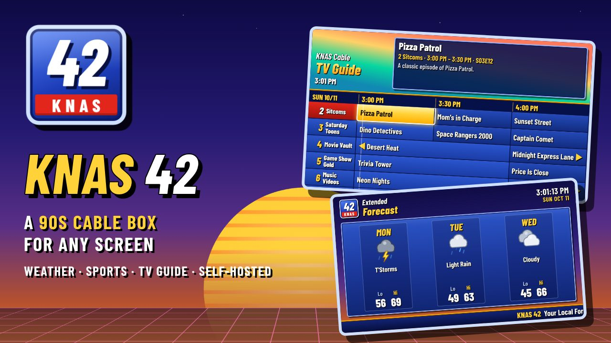
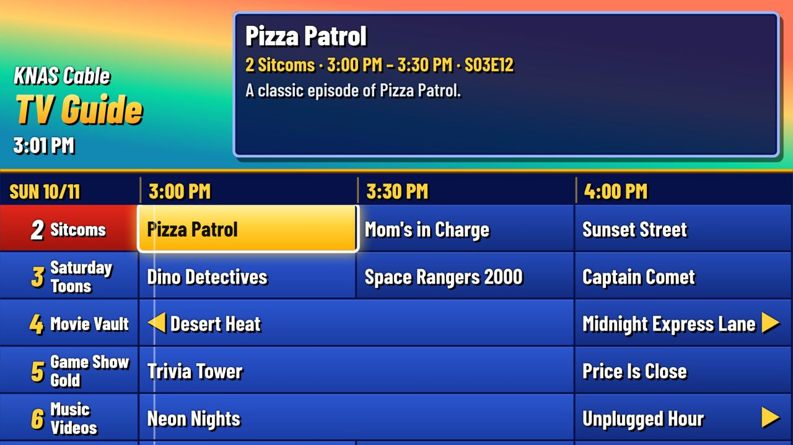
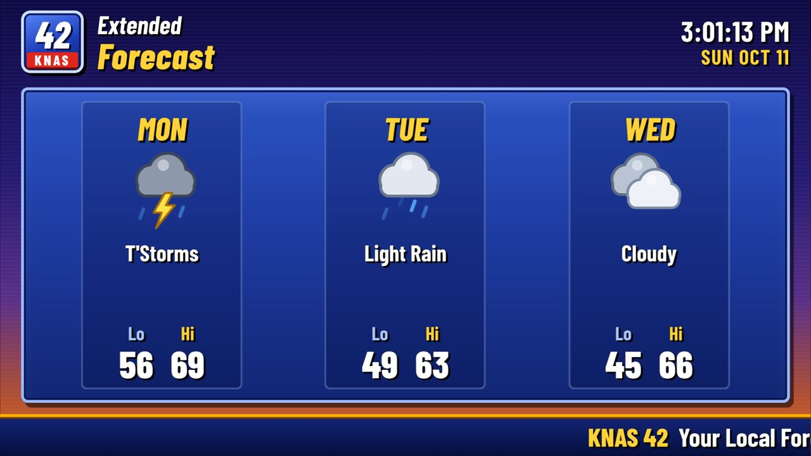
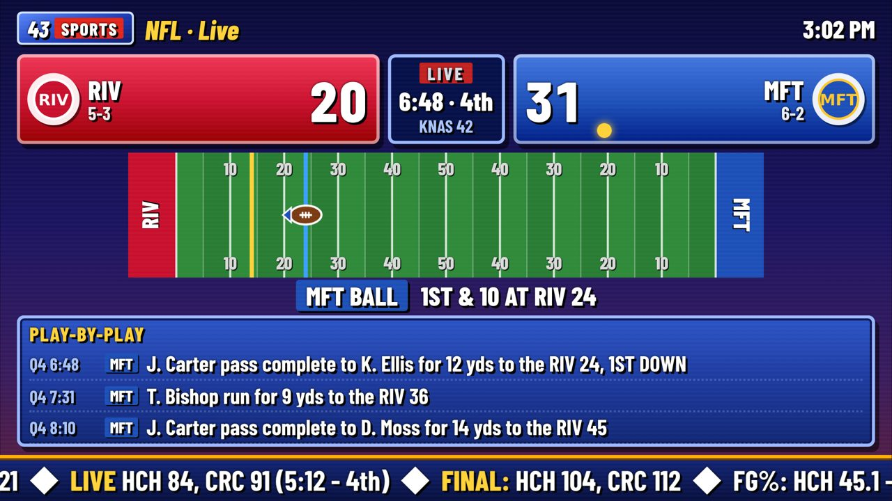
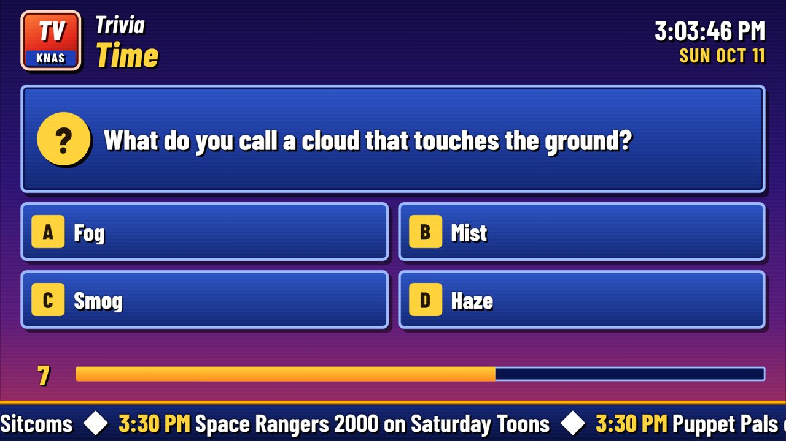
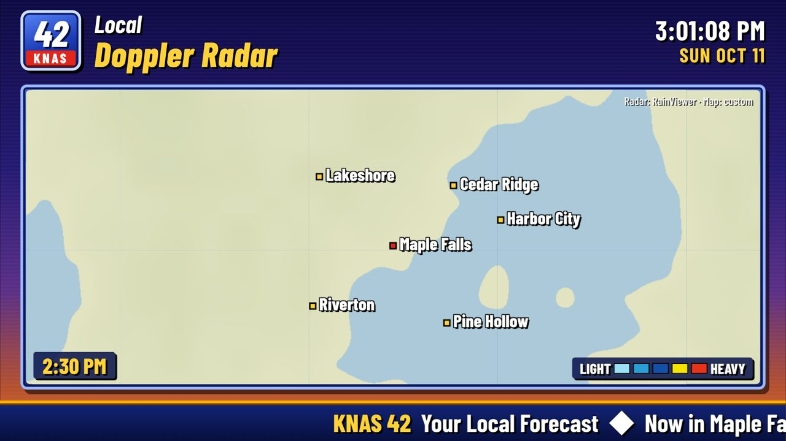
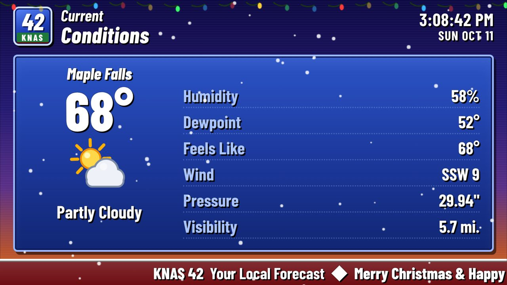
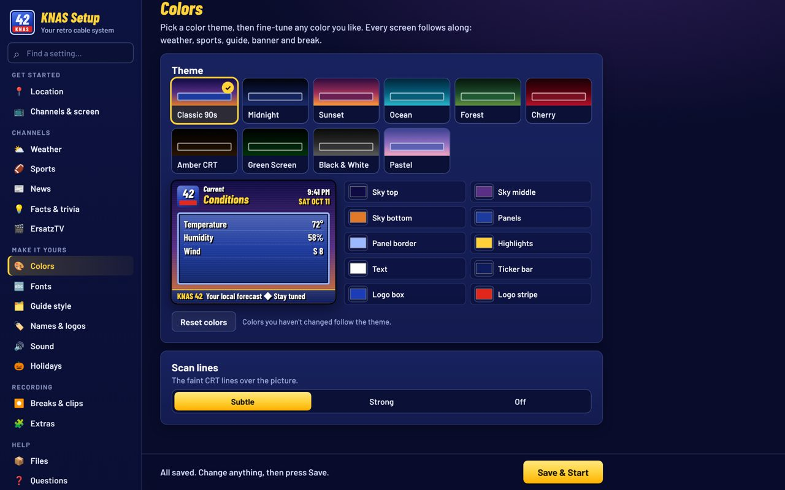

# KNAS 42 📺

**A 90s cable box for any screen.** Flip through channels with static in between, open a retro TV guide, and watch a "local forecast" weather channel, live scores for your teams and your own shows.

It runs on your home server in Docker. Watch it on any TV, computer, phone or old CRT that has a web browser. No accounts, no sign-ups, nothing to pay for.



---

## What you get

**The cable box**
- 📺 **A 90s cable box:** a retro TV guide, channel banners and static between channels. Works with a TV remote, a game controller, a keyboard and mouse, or swipes on a phone. Volume and mute built in.
- ⛅ **A weather channel:** your local forecast, a moving radar map, news headlines and smooth jazz, like the 90s weather channel.
- 🏈 **A sports channel:** live scores for your teams, play-by-play, a cheer when your team scores, and a radio station to go with it.
- ⏸️ **A "We'll be right back" screen:** trivia, fun facts and what's coming up next.
- 🎃 **Holiday looks:** snow at Christmas, bats at Halloween, fireworks on the Fourth, and more.
- 🎨 **Make it yours:** 10 color themes, 18 fonts, 5 guide styles (one color-codes sports, movies and kids shows), your own logos, and screens that fit any TV shape.

**Your own shows (optional)**
- 🎬 **ErsatzTV channels:** if you use [ErsatzTV](https://ersatztv.org), your shows and movies become channels in the guide.
- 📼 **Break clips:** KNAS makes short "we'll be right back" clips for ErsatzTV's filler, so shows start on the :00 and :30.
- ✂️ **Commercial breaks in your episodes:** the Tools page finds the act breaks in your shows (one episode or a whole library) so ErsatzTV can play commercials mid-episode, like real TV. If you use Jellyfin, KNAS tells it about the new breaks for you.

**Around the house**
- 📺 **An Android and Android TV app:** KNAS full screen on your TV box or phone, works with the TV remote, and can open by itself when the TV turns on.
- 📱 **Your phone as a remote:** open `/remote` to control any TV in the house: channels, guide, number pad and a volume slider, plus a **What's on** list of every channel with what's playing now and next. Name each TV, pick which channels it shows, or turn off every TV at once.
- 📊 **Viewing history** at `/history`: what each TV watched, top channels and shows, and when you watch. Turn it off any time in Setup → Channels.
- 🏆 **The Ratings** at `/ratings`: Nielsen-style weekly rankings of your house's top channels and shows, with ▲▼ arrows vs last week.
- 🎁 **KNAS Wrapped** at `/wrapped`: your year in TV, Spotify Wrapped style, with your top shows, biggest binge and TV personality.

**Experimental (hidden until you type a code on the setup page, all off until you turn them on)**
- 🎵 **Jukebox channel:** guests scan a QR code on the TV, search for songs (or paste YouTube links) and the music videos play one after another. The NAS downloads them first, so official music videos play too, with no ads. 🎤 **Karaoke mode** finds karaoke versions with the words on screen.
- 🎮 **Party games channel:** everyone plays on their phone: **Trivia**, **Name That Tune** (songs from your jukebox, sound only), **Word Race** (everyone solves the same five-letter word), **Bluff** (fake answers to strange-but-true facts), **Wheel Puzzle** (spin, call letters, solve) and **Draw It** (draw on your phone, everyone guesses). Leaderboard and podium.
- ⚠️ **Severe weather alerts (US):** National Weather Service warnings crawl across every TV, emergency-broadcast style, with the tones.
- 🏆 **Game time:** before your team plays, a heads-up box on the TVs, a phone alert, or the TVs switch to the game by themselves.
- 🍅 **Screen fun:** from your phone, flick a tomato (or pie, egg, snowball) and it splats on the TV; shake for confetti and fireworks; float emojis; or draw over the picture like a football telestrator.
- 🎯 **Flick games channel:** darts, hoops, bowling and cup pong for up to 6 players. Flick on your phone and it flies on the TV.
- 📡 **Stream channel:** paste a live stream link (YouTube live, Twitch, news streams) on your phone and it plays on its own channel, with favorites.
- 📤 **Throw it to the TV:** pick a photo or video on your phone, flick it up, and it flies onto the TV.
- 📹 **Live Cam channel:** any phone's camera becomes a live channel with a news-style "LIVE • KITCHEN" banner (up to 4 at once).
- 🎤 **Voice remote:** a mic button on the phone remote. "Put on King of the Hill", "channel 42", "volume up", "play Thriller on the jukebox".
- 🦆 **Duck Season:** a light-gun game where your phone is the gun. Zapper mode works like the old NES light guns (the screen flashes and the phone's camera checks your aim), so you really have to aim. Tilt mode is the easy one. Up to 4 players.

| | |
|:---:|:---:|
|  **The TV guide** |  **The weather channel** |
|  **Live sports** |  **Break screen trivia** |
|  **The radar map** |  **Holiday looks** |

---

## Install it

**You need:** a NAS or computer that's always on and runs Docker (UGREEN, Synology, QNAP, Unraid, a Linux PC, a mini PC or a Raspberry Pi 4/5).

### Step 1: Download it

Click the green **Code** button at the top of this page, then **Download ZIP**. Unzip it. You'll get a folder called something like `knas-retro-tv-main`. Copy that whole folder onto your NAS, for example into your `docker` folder.

### Step 2: Create the project in Docker

1. Open the **Docker** app on your NAS and go to **Project**. Click **Create**.
2. **Project name:** type the folder's name in lowercase, like `knas-retro-tv` (or `knas42`). Docker only accepts lowercase letters, numbers and dashes here.
3. **Storage path / location:** pick the KNAS folder you copied in step 1.
4. **Compose file:** choose the option to use the file that's already on your NAS, and pick the **`docker-compose.yml`** inside the KNAS folder. Some apps find it on their own once you pick the folder. Don't change anything in it.
5. Click **Deploy** (or **Build** / **Done**). The first time takes a minute or two while it downloads KNAS. After that it starts in seconds.

<details>
<summary>On Synology, Portainer or the command line?</summary>

- **Synology:** **Container Manager → Project → Create.** Give it a lowercase name, set the path to the KNAS folder, choose **Use existing docker-compose.yml**, then click through and **Done**.
- **Portainer:** its web editor can't build from a folder on your NAS. Use the command line below once instead.
- **Command line:**
  ```sh
  cd /path/to/the/knas/folder
  docker compose up -d
  ```
</details>

### Step 3: Check that it's working

On any computer or phone at home, open:

```
http://YOUR-NAS-IP:8642/tv
```

You should see the KNAS cable box with the weather channel on. Press **Enter** (or the OK button on a remote) to open the TV guide.

> **What's my NAS's IP?** It's your NAS's address on your home network, like `192.168.1.50`. It's in your NAS's network settings. The KNAS log in the Docker app also prints the exact links when it starts.

### Step 4: Bookmark these pages

| Page | Address | What it's for |
|---|---|---|
| **TV** | `http://YOUR-NAS-IP:8642/tv` | Watching. Open this on every TV, computer and phone. |
| **Setup** | `http://YOUR-NAS-IP:8642/setup` | Changing settings. Open it on any device at home. |
| **Remote** (optional) | `http://YOUR-NAS-IP:8642/remote` | On your phone: control any TV that has the cable box open. Add it to your home screen. |
| **Jukebox** (optional) | `http://YOUR-NAS-IP:8642/jukebox` | For guests: add YouTube videos to the jukebox channel. Turn the channel on in Setup → Channels & screen first. |
| **History** (optional) | `http://YOUR-NAS-IP:8642/history` | What each TV watched. |

**On an Android TV box (Onn, Chromecast with Google TV, Fire TV) or Android phone:** get the **KNAS 42 app** (the `.apk` on the [Releases](../../releases) page). It opens straight to the cable box, full screen, the TV remote just works, and it can open by itself when the TV turns on. [How to install it](docs/SETUP-GUIDE.md#android-tv-box-onn-chromecast-with-google-tv-fire-tv-and-android-phones).

**On other TVs:** open the TV link in the TV's web browser and bookmark it.

**KNAS already works at this point.** It figures out your town for the weather by itself. Everything in the next step is optional.

---

## Step 5: The setup page (all optional)

Open your **Setup** bookmark. The menu down the side has every section, and the **Find a setting** box jumps straight to anything. Rarely needed technical options are tucked away until you tick **Show advanced settings** at the bottom of the menu. Change what you want, then press **Save & Start** at the bottom. KNAS restarts with your changes in a few seconds. Refresh any screen that was already open.

| Section | What to do there |
|---|---|
| **Location** | KNAS guessed your town. If it's wrong, type your town, press **Find**, pick it from the list. Choose °F or °C. |
| **Channels & screen** | Your station's name and channel numbers. Pick **Classic 4:3** if you're watching on an old CRT TV. |
| **Weather** | Which weather pages to show, how long each stays up, your own scrolling message, and the map style. |
| **Sports** | Pick a sport, type your team's name, and click it. Add as many teams as you like. |
| **News** | Your local news station's website or your town's name, one per line. Press **Check** to test it. |
| **Facts & trivia** | Your own facts and trivia questions, plus topics to pull more from the internet. |
| **ErsatzTV & Jellyfin** | Only if you use ErsatzTV: type its address and press **Test**. Your channels then appear in the guide. If ErsatzTV gets your shows from Jellyfin or Emby, add that too so new commercial breaks show up by themselves. |
| **Look** | Colors, fonts, the guide's style, names, your own logos and holiday looks, all on one page with a live preview. |
| **Sound** | The volume leveler, so channels don't jump in loudness. |
| **Breaks & clips** | What the break screen shows, and short clips for ErsatzTV so shows start on the :00 and :30. |



---

## Common questions

**Do I need ErsatzTV?**
No. Without it you still get the weather, sports and break channels. ErsatzTV just adds your own shows and movies to the guide.

**What can I watch it on?**
Anything with a web browser: a TV box like an Onn or Fire TV, a smart TV, an Xbox, a computer, a phone, or an old CRT TV hooked up through a converter. On an Android TV box, [Fully Kiosk Browser](https://www.fully-kiosk.com/) works best.

**How do I update it?**
Download the new update `.zip` and drop it in the `updates` folder. Don't unzip it. KNAS updates itself within a minute and keeps all your settings.

**Where are my settings saved?**
In `settings.txt` in the KNAS folder. The setup page edits it for you.

**Something's not working?**
See the troubleshooting section at the end of the setup guide.

### 📖 [Full step-by-step guide](docs/SETUP-GUIDE.md)

The guide covers everything in detail: installing on each type of NAS, watching on every kind of device, connecting ErsatzTV, and setting up break clips for ErsatzTV (on the same NAS, on a Windows PC or on a Mac).

---

<details>
<summary><b>Technical details (ports, files, credits)</b></summary>

**Ports** (both containers use host networking)

| Port | What it's for |
|---|---|
| 8642 | The web pages and the setup page |
| 8643 | The weather channel as live video for ErsatzTV (off unless you turn it on) |
| 8644 | The break screen recorder (optional: only if break clips are on) |
| 8645 | The secure (https) address, for Live Cam, Duck Season and the voice remote |

**Your files:** settings are in `settings.txt`, your own facts and trivia are in `facts.txt` and `trivia.txt`, and your teams are in `teams.txt`. Updates never overwrite them.

**Credits**
- Weather and town lookup: [Open-Meteo](https://open-meteo.com).
- Guessing your town until you set one: [ipwho.is](https://ipwho.is), with [ipapi.co](https://ipapi.co) and [freeipapi.com](https://freeipapi.com) as backups (asked at most once a week, and never once you set a town).
- Radar: [RainViewer](https://www.rainviewer.com).
- Maps and town names: © [OpenStreetMap](https://www.openstreetmap.org/copyright) contributors.
- Scores: ESPN's public site API (unofficial, may change).
- Trivia: [Open Trivia Database](https://opentdb.com) (CC BY-SA 4.0).
- Facts and On This Day: Wikipedia.
- Video playback: [hls.js](https://github.com/video-dev/hls.js).
- Fonts (SIL Open Font License or Apache 2.0, licenses in `web/fonts`): Barlow, Barlow Condensed, Fira Sans Condensed, Roboto Condensed, Oswald, Asap Condensed, Saira Condensed, Lexend, Nunito, Bebas Neue, Exo 2, Righteous, VT323, Space Mono, Fredoka, Comic Neue, Patrick Hand, Roboto Slab, Playfair Display.

Not affiliated with any of the above, or with any real TV network or cable company. KNAS saves everything it downloads, so it's gentle on these free services.

</details>

## License

MIT, free to use, change and share. See [`LICENSE`](LICENSE).
